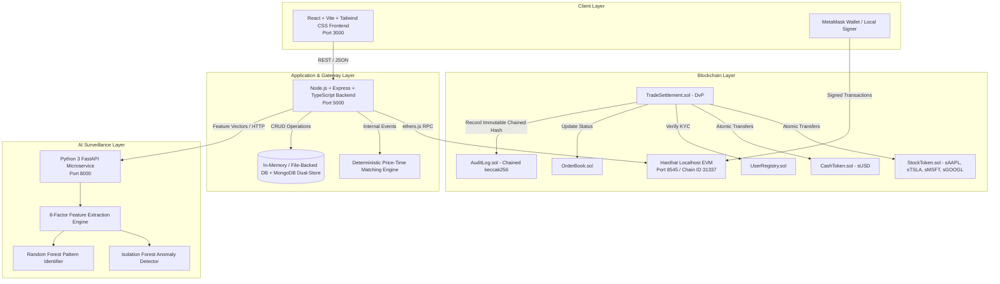
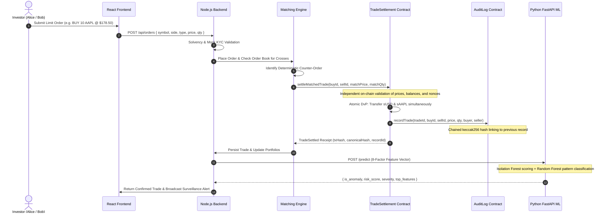

# LedgerTrade System Architecture

## 1. High-Level Architecture Overview

LedgerTrade is an academic, simulated fintech prototype designed for a B.Tech Data Science capstone. It demonstrates three core pillars:
1. **Decentralized Delivery-versus-Payment (DvP) Settlement** via Ethereum smart contracts.
2. **Cryptographic Tamper-Evident Audit Logging** with sequential keccak256 chaining and Merkle tree checkpoints.
3. **Real-Time AI Market Surveillance** utilizing an unsupervised Isolation Forest and multi-class supervised Random Forest.

---

## 2. Vertical Slice Execution Flow

---

## 3. Trust Boundaries & Academic Disclaimers

### Order Matching Trust Boundary
Smart contracts do not spontaneously execute background daemons or loops. Therefore, order matching occurs through an explicit transaction triggered either by the matching engine backend or a participating broker. However, the `TradeSettlement.sol` smart contract enforces **zero-trust execution**: it independently re-validates participant KYC, order states, price boundaries, token allowances, and delivery conditions before moving any assets.

### Synthetic Market Data Scope
All instruments (AAPL, TSLA, MSFT, GOOGL), cash balances (sUSD), and equity tokens (sAAPL, sTSLA) are **100% simulated prototype assets**. The system connects to no real-world exchanges, securities brokers, or banking networks.
